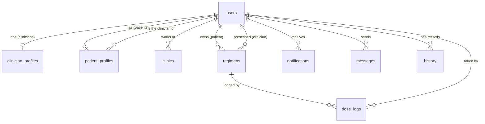
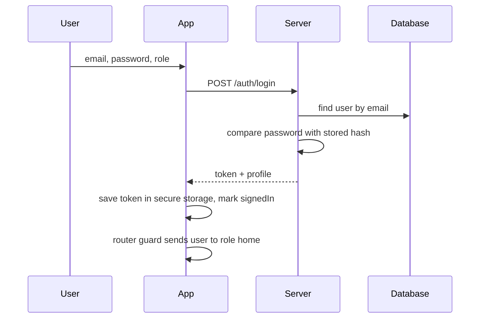
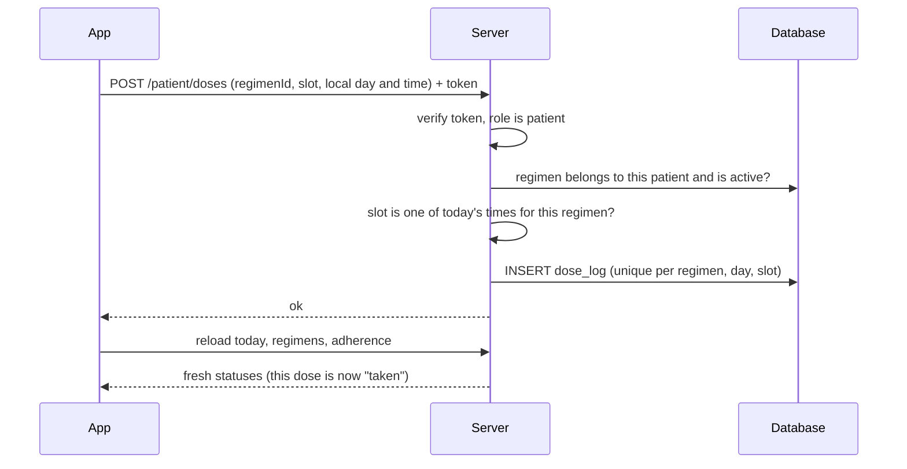

# Therapy Pal: Architecture

**What this is:** a technical map of how Therapy Pal is built, why it is built that way, and where it will need to grow.

**How to read it:** technical terms are used on purpose (they are the words engineers use), and every time one appears it is followed by a plain-language explanation in parentheses. Example: "the app calls the API (the list of requests the server understands)".

**Snapshot:** about 4,300 lines of Dart in `mobile/` (the Flutter app) and about 1,060 lines of JavaScript in `server/` (the Node.js server). Versions are those installed in October 2026.

---

## 1. System at a glance

Therapy Pal is a **client-server architecture** (a design where a program on the user's device asks a separate program on a computer to do the shared work) with **three tiers** (three layers: what the user sees, the rules, and the stored data).

```
 TIER 1: PRESENTATION              TIER 2: APPLICATION               TIER 3: DATA
 (what the user sees)              (the rules and logic)             (what is remembered)

 Flutter app  (mobile/)            Express server  (server/)         SQLite database file
 phone / tablet / laptop           Node.js, one process              server/data/therapy_pal.db
        |                                 ^    |
        |   HTTP + JSON over REST         |    +-- reads and writes -----> SQLite (same process)
        +-------------------------------->|
          (requests and replies as plain text, in a standard web style)
```

- **Two roles, one codebase.** Every account is either a *patient* (follows a treatment plan, logs doses) or a *clinician* (watches a panel of patients, assigns treatments, messages them). Both use the same app and the same server; the account's role decides which screens and which data they can reach.
- **Monolith** (one server program that does everything, rather than many small cooperating services). It is the right size for this project: simple to run, simple to debug.
- **Stateless server** (the server keeps no memory of you between requests; every request carries its own proof of identity). This is what lets the server restart at any time without logging anyone out.

---

## 2. Repository layout

```
Therapy_pal/
├── README.md                 how to run it
├── docs/ARCHITECTURE.md      this file
├── server/                   TIER 2 + TIER 3
│   ├── package.json          list of packages (ready-made code libraries) the server needs, plus run scripts
│   ├── .env.local            settings kept out of the code (secrets, port, database path)
│   ├── test-api.ps1          manual end-to-end check of every endpoint (PowerShell script)
│   ├── data/                 the SQLite database file lives here (kept out of the change history on purpose)
│   └── src/
│       ├── server.js         entry point: builds the app, wires the middleware (checkpoints every request passes through), starts listening
│       ├── seed.js           fills the database with demo data
│       ├── lib/              shared building blocks
│       │   ├── db.js           database connection, schema (the blueprint of the tables), small query helpers
│       │   ├── auth.js         login tokens (signed digital passes) and access checks
│       │   ├── http.js         input validation (checking input is acceptable) helpers and the error type
│       │   ├── adherence.js    the core calculation: taken / missed / due / upcoming
│       │   ├── notify.js       creates notifications
│       │   └── dto.js          shapes database rows into API (the server's list of requests) replies
│       └── routes/           one file per area of the API (the server's list of requests)
│           ├── auth.js         register, login, profile, preferences
│           ├── patient.js      regimens, doses, logs, adherence, history
│           ├── clinician.js    patient panel, assigning regimens, analytics
│           └── shared.js       notifications and messaging (both roles)
└── mobile/                   TIER 1
    ├── pubspec.yaml          list of packages (ready-made code libraries) the Flutter app uses
    ├── .env.local            build-time settings (the server address)
    ├── test/                 automated tests
    └── lib/
        ├── main.dart           entry point: creates the shared services and starts the app
        ├── router.dart         the screen map and the sign-in/role guards (rules that send you to the right place)
        ├── core/               plumbing: server client, config, formatting, breakpoints (window widths where the layout changes), design tokens (named colours and sizes)
        ├── state/session.dart  who is signed in, plus the unread counters
        ├── widgets/            reusable widgets (screen building blocks): buttons, cards, charts, navigation, page frame
        └── screens/            the actual screens: auth, patient/, clinician/, thread
```

---

## 3. Technology stack

| Layer | Choice | Why it fits |
|---|---|---|
| App framework | Flutter 3.44 / Dart 3.12 | One codebase (a single set of source files) produces Android, iOS and web apps |
| Screen navigation | `go_router` 17 | Declarative routing (you describe the map of screens and the app follows it) with sign-in guards |
| Shared app memory | `provider` 6 | A light **state management** (a way for the app to remember and share information) tool built into Flutter's own patterns |
| Server calls | `http` 1.6 | Plain, well-supported HTTP (the language apps and websites use to talk to servers) client (the part that sends requests to the server) |
| Token (the signed digital pass the server issues at login) storage | `flutter_secure_storage` 11 | Keeps the login pass in the phone's protected storage (Keychain on iOS, Keystore on Android) |
| Fonts, dates, logo | `google_fonts`, `intl`, `flutter_svg` | Plus Jakarta Sans typeface, date formatting, the SVG (resolution-independent image) logo |
| Server runtime | Node.js 22.13+ (tested on 24), ES modules | JavaScript on the server; ES modules (the modern `import`/`export` file system for code) |
| Web framework | Express 5.2 | The most widely used Node framework; version 5 forwards errors from handlers (functions that answer a request) automatically |
| Database | SQLite via Node's built-in `node:sqlite` | A whole database in one file (no separate database server to install or run) |
| Validation (checking that input is acceptable) | `zod` 4 | Describes the exact shape of acceptable input and rejects anything else |
| Security packages | `helmet`, `cors`, `express-rate-limit`, `jsonwebtoken`, `bcryptjs` | Safer response headers (labels attached to a request or reply), cross-site rules, request caps, login passes, password scrambling |
| Dev tooling | `nodemon` | Restarts the server when source files change (see section 10) |

---

## 4. The server in detail

### 4.1 Layers inside the server

A request travels through these layers in order. Each layer has one job.

1. **Entry point** (`server.js`, the file Node starts first) builds the Express app and starts listening on a port.
2. **Middleware pipeline** (a chain of checkpoints every request passes through before reaching real code).
3. **Routers** (code that matches a web address to the right function; `routes/*.js`) contain the **handlers** (the functions that answer one kind of request).
4. **Domain logic** (the business rules, here in `lib/adherence.js` and `lib/notify.js`) does the real thinking, such as deciding whether a dose was missed.
5. **Data access** (`lib/db.js`, the only code that talks to the database) runs SQL (the language databases understand) with small helpers `get`, `all`, `run` and `tx`.
6. **DTO mapping** (`lib/dto.js`; DTO means "data transfer object", a reply shaped specifically for sending out) converts database rows into the tidy JSON (plain-text structured data) the app expects, for example `patient_id` becomes `patientId`.

There is deliberately **no ORM** (a library that hides database commands behind objects). With nine tables, plain SQL (the language databases understand) is shorter and easier to read.

### 4.2 The middleware pipeline (the chain of checkpoints every request passes through)

In the order they run in `server.js`:

| Step | What it does |
|---|---|
| `helmet` | Adds safety **headers** (small labels attached to every reply that tell browsers to be cautious) |
| `cors` | **CORS** (a browser rule about which websites may call this server) allows the origins listed in `CORS_ORIGIN`; `*` means "any", fine for development only |
| `express.json` | Reads the request body as JSON (plain-text structured data) and refuses bodies over 100 KB |
| `rateLimit` on login and register | **Rate limiting** (a cap on attempts in a time window): 30 logins per 15 minutes and 20 sign-ups per hour per address, which slows password guessing |
| Routers (code that sends each request to the right place) | `/api/auth`, `/api/patient`, `/api/clinician`, then the shared router (the code that sends each request to the right place) at `/api` |
| 404 handler (the function that answers requests nobody else matched) | Anything unmatched becomes a "Route not found" error |
| Error handler (the function that catches every failure) | Turns any thrown error into a consistent reply (section 4.6) |

### 4.3 The API surface (the full list of requests the server understands)

A **REST API** (a server menu organised around "things", like regimens and messages, using standard web actions: GET to read, POST to create, PATCH to change) with 25 **endpoints** (specific web addresses the server answers). All paths start with `/api`. "Who" lists the roles allowed in.

| Method and path | Who | Purpose |
|---|---|---|
| `GET /health` | anyone | Is the server alive? |
| `POST /auth/register` | anyone | Create a patient or clinician account |
| `POST /auth/login` | anyone | Exchange email and password for a token (the signed digital pass the server issues at login) |
| `GET /auth/me` | signed in | The current user's profile |
| `PATCH /auth/me` | signed in | Edit name, email, phone |
| `PATCH /auth/me/prefs` | signed in | Edit notification preferences |
| `GET /patient/regimens` | patient | The patient's treatment items |
| `POST /patient/regimens` | patient | Add an item themselves |
| `PATCH /patient/regimens/:id` | patient | Pause, resume, or edit a note |
| `GET /patient/today` | patient | Today's doses with status |
| `POST /patient/doses` | patient | Log a dose as taken |
| `GET /patient/logs` | patient | Last 14 days of taken and missed doses |
| `GET /patient/adherence` | patient | 30-day rate, streak, weekly trend, "where doses slip" |
| `GET /patient/history` | patient | Medical history records |
| `GET /clinician/patients` | clinician | The panel, with adherence per patient |
| `GET /clinician/patients/:id` | clinician | One patient in detail |
| `POST /clinician/patients/:id/regimens` | clinician | Assign a regimen item (notifies the patient) |
| `POST /clinician/patients/:id/history` | clinician | Add a history record (no screen uses this yet) |
| `POST /clinician/patients/link` | clinician | Add an existing patient account to the panel |
| `GET /clinician/analytics` | clinician | Panel averages, 8-week trend, missed-dose timing |
| `GET /notifications` | signed in | Alerts feed (also creates due reminders, see 4.7) |
| `POST /notifications/read-all`, `/:id/read` | signed in | Mark as read |
| `GET /messages/threads` | signed in | Conversation list with unread counts |
| `GET /messages/threads/:patientId` | signed in | One conversation (also marks it read) |
| `POST /messages/threads/:patientId` | signed in | Send a message |

### 4.4 Authentication (proving who you are) and authorization (deciding what you may do)

**Authentication** (proving who you are):

1. Registration stores a **hash** (a one-way scrambling, so the real password is never stored) made with `bcryptjs` at cost factor 12 (the scrambling is deliberately slow, which makes mass guessing expensive).
2. Login checks the password and returns a **JWT** (JSON (plain-text structured data) Web Token (the signed digital pass the server issues at login): a digitally signed pass containing your user id and role) valid for 7 days by default. It is signed with `JWT_SECRET`, so the server can detect forgery.
3. The app attaches the token (the signed digital pass the server issues at login) to every request in an `Authorization: Bearer <token>` header (a label on the request carrying the pass).
4. `requireAuth` (a **middleware (a checkpoint every request passes through)**, a checkpoint) verifies the signature, then **looks the user up in the database on every request**. If an account is deleted, its token (the signed digital pass the server issues at login) stops working at once even though it has not expired.
5. Failed logins return the same message for "unknown email" and "wrong password", so an attacker cannot learn which emails exist.

**Authorization** (deciding what you may do) has three layers:

- **Role checks.** `requireRole('patient')` and `requireRole('clinician')` guard whole routers (groups of endpoints (web addresses the server answers)).
- **Ownership checks.** Patient endpoints (web addresses the server answers) always use the id from the token (the signed digital pass the server issues at login), never an id sent by the app, so a patient cannot ask for someone else's data. Clinician endpoints (the requests only clinicians may send) call `ownPatient()`, which confirms the patient is on that clinician's panel, otherwise the answer is "not found".
- **Pair checks** for messages. `resolvePair()` works out the (patient, clinician) pair from the token (the signed digital pass the server issues at login) and rejects any pair that is not linked.

### 4.5 Validation (checking that input is acceptable)

Every write endpoint (a web address the server answers) passes its input through a **`zod` schema** (a written description of the exact shape and limits allowed, such as "time must look like HH:MM"). Bad input becomes a 400 error with a field-by-field list of problems. Registration uses a **discriminated union** (a blueprint that picks its rules from one field, here `role`) so patients and clinicians are validated differently.

### 4.6 Error handling

Code throws an `HttpError` (an error carrying a status code: 400 bad input, 401 not signed in, 403 not allowed, 404 not found, 409 conflict). One **error handler** (a single place that catches all failures) converts it to `{ "error": { "message", "details?" } }`. Unexpected failures return a generic "Something went wrong" with status 500 and are logged on the server, so internals never leak to the user.

### 4.7 Domain logic: deriving adherence instead of storing it

This is the most important design idea in the server (`lib/adherence.js`).

- The database stores only **what happened**: a row in `dose_logs` when a patient marks a dose taken.
- **"Missed", "due" and "upcoming" are computed on demand** (calculated when asked rather than saved). The server expands each active regimen into its daily time slots, matches them against the logs, and labels each slot:
  - **taken**: a log exists
  - **missed**: no log and the day is over, or the slot is more than 180 minutes old (`MISSED_AFTER_MIN`)
  - **due**: the slot time has arrived but is within the 180-minute grace window
  - **upcoming**: still in the future today
- **Why derive?** There is no background job to keep up to date and no stored "missed" record that could go out of sync (this is called a single source of truth: one place holds the facts, everything else is calculated from it). Pausing a regimen or changing its times instantly changes the numbers.
- From the same slot list come the summaries: the adherence rate (taken divided by taken-plus-missed), "missed by time of day", the weekly trend, and the streak of clean days.
- **Client-supplied clock.** The app sends its local `day` and `time` as query parameters (values added to the web address) so "today" matches the user's time zone. The server validates the format and falls back to its own clock if they are missing.
- **Start boundary.** A new regimen records `start_time`, so doses scheduled earlier on its first day are not counted as missed.

### 4.8 Notifications

`lib/notify.js` creates alerts of four kinds: `reminder`, `regimen`, `message`, `alert`.

- It checks the recipient's **preferences** first (for example, a user who turned off missed-dose alerts gets none).
- Each notification can carry a **dedupe key** (a unique label such as `miss:<regimen>:<day>:<slot>`) backed by a database **unique constraint** (a rule that forbids two rows with the same value), so the same alert is never created twice.
- **There is no scheduler** (a timer that runs jobs in the background). Reminders ("take X in 30 minutes", "time to take X") and missed-dose alerts are created **lazily** (only when needed) the moment a patient's app asks for `GET /notifications`. That keeps v1 simple, with the trade-off that nothing arrives while the app is closed.

### 4.9 Messaging

A conversation is not its own table; it is simply every message sharing the same `(patient_id, clinician_id)` pair. This is enough because each patient has one clinician. Unread counts are calculated from the `read` flag, and opening a conversation marks the other person's messages as read.

### 4.10 Configuration

Settings live in **environment variables** (named settings kept outside the code) loaded from `server/.env.local` by Node's `--env-file` option. The file is git-ignored (left out of the change history on purpose) so secrets never reach version control (the change history).

| Variable | Meaning |
|---|---|
| `JWT_SECRET` | Signing key for login passes. If empty in development a random temporary one is used (logins reset on restart); in production the server refuses to start without it |
| `JWT_EXPIRES_IN` | Pass lifetime, default `7d` |
| `PORT` | Default 4000 |
| `DB_PATH` | Database file, default `./data/therapy_pal.db` |
| `CORS_ORIGIN` | Allowed website origins, `*` for development |
| `SEED_DEMO_DATA` | `true` loads demo data into an empty database at start |

---

## 5. The data layer

### 5.1 Entity relationships

An **ER diagram** (entity-relationship diagram: boxes for tables, lines for how they connect):



### 5.2 Tables

The **schema** (the blueprint of the database) has nine tables, created automatically at startup with `CREATE TABLE IF NOT EXISTS`.

| Table | Holds | Notable rules |
|---|---|---|
| `users` | Every account | `role` limited to patient or clinician (a **CHECK constraint**, a rule the database enforces); `email` unique and case-insensitive; `prefs` stored as a small JSON (plain-text structured data) text |
| `clinician_profiles` | NPI number, specialization, licence | One row per clinician (the user id is the **primary key**, the unique identity of a row) |
| `clinics` | A clinician's affiliated clinics | Many per clinician |
| `patient_profiles` | The patient's care plan and link to their clinician | `clinician_id` is a **foreign key** (a rule that a pointer must refer to a record that exists) that becomes empty if the clinician is removed |
| `regimens` | Treatment items: name, strength, `medication` or `therapy`, schedule text, `times` (a JSON (plain-text structured data) list such as `["08:00","20:00"]`), `started`, `start_time`, `active` | Linked to patient and prescriber; `prescriber_id` empty means the patient added it |
| `dose_logs` | One row per dose taken | **Unique on (regimen, day, slot)**, so a dose cannot be logged twice |
| `notifications` | Alerts feed | `dedupe_key` unique (section 4.8) |
| `messages` | Chat messages | Carries the patient, clinician, sender and a `read` flag |
| `history` | Medical history records | Per patient |

### 5.3 Database behaviour

- **WAL mode** (write-ahead logging: changes go to a side journal first, so readers are not blocked by writers) and `foreign_keys = ON` are set at startup.
- **Indexes** (lookup shortcuts that make searches fast) exist on regimens by patient, logs by patient and day, notifications by user and time, and messages by pair and time.
- `tx()` wraps several changes in a **transaction** (a bundle of changes that all succeed or all roll back). Registration uses it so a half-created account can never exist.
- `node:sqlite` is **synchronous** (each query finishes before the next line runs). For a small single-server app this is faster and simpler than asynchronous drivers, but it is one reason SQLite suits only modest traffic.
- **Seeding** (`seed.js`) builds demo data with a **deterministic pseudo-random generator** (a random-looking sequence that is identical every run for the same seed name), so every reset produces the same story. Demo data is generated relative to the day you run it, so it ages; run `npm run reset` to refresh.

---

## 6. The app in detail

### 6.1 Layers inside the app

| Layer | Folder | Responsibility |
|---|---|---|
| Entry and wiring | `main.dart`, `router.dart` | Creates the shared services, builds the theme, defines the screen map |
| Core | `core/` | `api.dart` (server client), `config.dart` (server address), `format.dart` (dates, times, names), `responsive.dart` (screen-size rules), `tokens.dart` (colours, radii, shadows) |
| State | `state/session.dart` | Who is signed in and the unread counters |
| Design system | `widgets/` | Reusable **widgets** (Flutter's building blocks for anything on screen): cards, buttons, tags, charts, navigation, page frame |
| Features | `screens/` | One file group per area: auth, patient, clinician, messaging thread |

### 6.2 Start-up and sharing services

`main.dart` creates three long-lived objects and offers them to the whole app through `provider`. This is **dependency injection** (handing a component what it needs rather than letting it build its own), and it is why tests can swap the real server client for a fake one.

- `Api`: the only code that talks to the server.
- `Session`: the signed-in user.
- `Badges`: unread counts for the navigation.

### 6.3 State management (how the app remembers and shares information)

- **`Session`** is a `ChangeNotifier` (an object that announces "I changed" so screens listening to it redraw). It holds the auth status (`booting`, `signedOut` or `signedIn`) and the user's profile. On start it reads the saved token (the signed digital pass the server issues at login) from secure storage, asks `GET /auth/me` whether it is still valid, and enforces a minimum 1.4-second splash screen so it does not flash.
- **`Badges`** is a second notifier holding unread alerts (patients) or unread messages (clinicians). It refreshes on tab changes and after relevant actions.
- Everything else is **local state** (memory belonging to a single screen, such as which filter chip is selected). There is no global store for server data on purpose: each screen asks fresh each time.
- Server data travels as untyped maps (`Map<String, dynamic>`, key-value bags with no fixed fields). That kept v1 fast to build; the cost is that a misspelled key fails at run time instead of at build time (see roadmap).

### 6.4 Talking to the server (`core/api.dart`)

- Three methods: `get`, `post`, `patch`, each returning decoded JSON (plain-text structured data).
- Adds the `Authorization` header (a label attached to a request or reply) when a token (the signed digital pass the server issues at login) exists, and a **15-second timeout** (a limit after which it gives up).
- For GET requests it can attach the device's local `day` and `time` (`withNow: true`).
- Failures become one error type, `ApiException`, with a human-readable message. A network failure reads "Can't reach the server at <address>", which includes the address it tried, because that is the most common setup mistake.
- A 401 reply while signed in triggers `onUnauthorized`, which signs the user out cleanly (their pass expired or the account is gone).
- **Server address (`config.dart`).** It comes from the build-time setting `API_BASE_URL` (passed with `--dart-define-from-file=.env.local`). If empty: Android emulator uses `10.0.2.2` (the emulator's name for the host computer), everything else uses `localhost`.

### 6.5 Navigation (`router.dart`)

`go_router` holds a single map of screens plus rules:

- **Redirect guard** (a rule that bounces you to the right place): while `booting` you see the splash; when `signedOut` you can only reach `/login` and `/register`; when `signedIn` you are sent to your role's home, and a patient who types a clinician URL is sent home. `refreshListenable: session` makes the guard re-run the moment sign-in status changes.
- **Two `StatefulShellRoute` structures** (a persistent frame with tabs that each remember their own place): one for patients with five tabs (Home, Regimen, Logs, Alerts, Profile) and one for clinicians (Dashboard, Patients, Messages, Analytics, Profile).
- **Nested routes** (screens that open on top of a tab): for example `/patient/profile/history`, `/clinician/patients/:id` and `/clinician/messages/:id`.

### 6.6 The loading pattern (`widgets/page.dart`)

`Loader<T>` is a generic widget (one reusable component that works for any data type) that runs a request and shows one of three states: a spinner, an error with a retry button, or the screen built from the data. It exposes a **silent reload** (refresh without flashing a spinner) used by pull-to-refresh and after actions such as logging a dose. `PageScaffold` is the standard frame: header (a label attached to a request or reply), scrolling list, optional footer, centred and width-limited on big screens.

### 6.7 Responsive layout system

Defined in `core/responsive.dart` and applied through `widgets/nav.dart` and `widgets/page.dart`.

**Breakpoints** (window widths where the layout switches):

| Tier (layer) | Width | Navigation |
|---|---|---|
| Compact (phone) | under 768 px | Bottom tab bar |
| Medium (tablet) | 768 to 1279 px | 72 px icon rail on the left + top bar |
| Expanded (laptop) | 1280 px and up | 260 px sidebar with labels and sign-out + top bar |

`RoleShell` (the frame around all tab screens) chooses among the three. Inside pages, small layout helpers adapt to the space actually available (measured with `LayoutBuilder`, a widget (a screen building block) that reports how much room its parent gave it):

- `MainAside`: two columns (main content plus a side panel of about 34% width) when there are 900 px or more, otherwise stacked.
- `GridList`: as many equal columns as fit given a minimum card width.
- Page **gutters** (side margins) are 16, 24 and 32 px; content is capped at 1200 px (1100 on profile-style pages, 880 for list pages, 560 for forms) and centred.
- The clinician inbox is a **master-detail view** (list on the left, selected item on the right) on tablets and laptops, and two separate screens on phones.

### 6.8 Design system

- **Design tokens** (named design values reused everywhere) live in `core/tokens.dart` as the `TP` class: teal primary `#0C7B85`, canvas `#F1FBFF`, status colours (success, warning, danger), card radius 16, control radius 10, and two shadow levels.
- Text goes through one helper, `tpText()`, using Plus Jakarta Sans. A flag (`tpUseDeviceFonts`) lets tests skip font downloads.
- `widgets/ui.dart` holds the shared components: `TpCard`, `RowItem`, `Tag`, `RatePill`, `TpButton`, `TpField`, `Seg` (a two-option toggle), `PageHeader`, `ChipRow`, and `LogoMark`. `widgets/charts.dart` draws the ring, bar chart, sparkline and meters with **custom painters** (code that draws shapes directly on the screen), so no charting library is needed.

### 6.9 Screen inventory

| Route | Role | Server calls |
|---|---|---|
| `/login`, `/register` | public | `POST /auth/login`, `POST /auth/register` |
| `/patient/home` | patient | regimens, today, adherence; log a dose, add or pause a regimen |
| `/patient/regimen` | patient | regimens |
| `/patient/logs` | patient | logs |
| `/patient/alerts` | patient | notifications, mark read |
| `/patient/profile` (+ `history`, `adherence`, `contact`) | patient | regimens, history, adherence, `/auth/me`; `PATCH /auth/me` |
| `/patient/profile/messages` | patient | thread read and send |
| `/clinician/dashboard` | clinician | patients, threads |
| `/clinician/patients`, `/clinician/patients/:id` | clinician | patients, patient detail, link patient, assign regimen |
| `/clinician/messages`, `/clinician/messages/:id` | clinician | threads, thread read and send |
| `/clinician/analytics` | clinician | analytics |
| `/clinician/profile` (+ `clinic`, `prefs`) | clinician | `/auth/me`, `PATCH /auth/me/prefs` |

---

## 7. Key flows

### 7.1 Signing in



In the diagram, "token" is the signed digital pass the server issues at login, and "hash" is the one-way scrambled copy of the password.

### 7.2 Logging a dose



Here too, "token" means the signed digital pass. A repeat tap is rejected by the unique rule (409 "already logged"), so a double-tap cannot create a duplicate.

### 7.3 Clinician assigns a regimen item

The clinician's app posts to `/clinician/patients/:id/regimens`. The server confirms the patient is on that clinician's panel, inserts the regimen (with the clinician as prescriber), and creates a `regimen` notification for the patient ("New regimen assigned by Dr. ..."). The patient sees it the next time their app loads alerts.

### 7.4 Messaging

Both sides post to `/messages/threads/:patientId`; the server stores the message and creates a `message` notification for the recipient. There are no live connections. The conversation screen uses **polling** (the app asks "anything new?" on a timer): every 10 seconds inside a chat and every 12 seconds for the clinician inbox list. Pull-to-refresh is also available.

---

## 8. Cross-cutting concerns

**Security summary**

| Area | Current measure |
|---|---|
| Passwords | bcrypt hash (a one-way scrambling of the password), cost 12; 8-character minimum at sign-up |
| Sessions | Signed 7-day token (the signed digital pass the server issues at login); user re-checked in the database on every request |
| Abuse | Rate limits on login and sign-up; 100 KB body limit; `helmet` headers (labels attached to a request or reply) |
| Data access | Role checks plus ownership checks on every clinician and message endpoint (a web address the server answers) |
| Token (the signed digital pass the server issues at login) storage | Phone secure storage (Keychain or Keystore). On web it falls back to browser storage, which is weaker |
| Transport | Plain HTTP (the language apps and websites use to talk to servers) in development only. Android cleartext and iOS local-networking exceptions are switched on and **must be removed**, with HTTPS (encrypted web traffic) used, before release |

**Time zones.** All "today" logic uses the device's clock as sent by the app. Timestamps such as message times are stored in UTC (the universal time standard) and converted to local time on screen.

**Performance.** Data volumes are small. Known hot spot: the clinician patient list runs one adherence calculation per patient (the "N+1" pattern, one extra query per row), fine for dozens of patients but worth batching for hundreds.

**Testing.**
- `mobile/test/format_test.dart`: 6 unit tests (small tests of one function) for time, name and date helpers.
- `mobile/test/responsive_test.dart`: 14 **widget tests** (tests that draw real screens in a simulated window) rendering every screen for both roles at seven window sizes from 390 px to 1920 px. They run against a **mock server** (a fake stand-in that returns canned replies) and fail on any layout overflow or exception. This works because `Api` accepts an injected HTTP (the language apps and websites use to talk to servers) client.
- `server/test-api.ps1`: a manual **smoke test** (a quick check that the main paths work) covering every endpoint (a web address the server answers) and the role and login rules.
- There are no automated tests for the server code yet (see roadmap).

---

## 9. Architectural decisions

| Decision | Alternatives considered | Why this one | Trade-off accepted |
|---|---|---|---|
| SQLite in one file | PostgreSQL, MongoDB | Zero setup, easy backup (copy a file), enough for one server | One writer at a time; will need PostgreSQL for many users or several servers |
| `node:sqlite` built in | `better-sqlite3`, an ORM (a library that hides database commands behind objects) | No native compilation (building code for your specific machine) on Windows | Newer module; API (the server's list of requests it understands) may change |
| Adherence derived, not stored | A nightly job writing "missed" rows | Always correct, no background job | Recomputed on each request |
| JWT (stateless (the server remembers nothing between requests) pass) | Server-side sessions | Simple, works for web and mobile | Cannot revoke a pass before it expires |
| Client sends its local day and time | Server computes "today" | Correct in any time zone | The server trusts the client's clock (a user could back-date their own doses) |
| Polling (asking the server for news on a timer) for messages | WebSockets (a permanent two-way connection) | Much simpler; no extra infrastructure | Up to 10 seconds of delay; extra requests |
| Reminders created on fetch | Push notifications with a scheduler | No external service needed in v1 | Nothing arrives while the app is closed |
| `provider` plus plain widgets (building blocks of the screen) | Bloc, Riverpod (heavier state tools) | Few moving parts for a small app | Server data is not shared between screens, so each screen re-fetches |
| Untyped maps for server data | Typed model classes | Fast to build | Typos surface at run time |
| `nodemon` for development reload | Node's `--watch` | On Windows, Node's watcher treats a file being merely read as a change and restarts the server repeatedly | One extra dev dependency |

---

## 10. Lessons learned during the build

- **`node --watch` on Windows** restarted the server whenever a file was read after a long idle period, which dropped the first login request and showed up in the app as "can't reach the server". Replaced by `nodemon`.
- **Running two server copies** on the same database can cause "disk I/O error" on SQLite's journal files. Run exactly one.
- **A navigation bar inside a Flutter `Scaffold` slot** that used a `Column` without `mainAxisSize: min` (a setting that makes a column only as tall as its contents) expanded to the full screen and hid every page. Widget tests (tests that draw real screens in a simulated window) that render real screens are what caught it.

---

## 11. Known limitations and roadmap

Ordered by value for effort.

1. **Typed models in the app** (replace raw maps with defined classes), so mistakes are caught before running.
2. **Automated server tests** (unit tests (small tests of one function) for `adherence.js`, integration tests that call the API (the server's list of requests it understands) against a throwaway database), plus **CI** (a service that runs all tests automatically on every change).
3. **Schema migrations** (versioned, repeatable database changes). Today only new tables are created automatically; changing an existing table needs a manual step.
4. **Refresh tokens and revocation** (short-lived passes renewed quietly, with the ability to cancel one), plus a real "sign out everywhere".
5. **Fix the 6-week trend window.** The adherence endpoint (a web address the server answers) charts six weeks but only loads 30 days of data, so older weeks appear empty. Load 42 days.
6. **Push notifications and a scheduler**, so reminders arrive when the app is closed.
7. **Real-time messaging** over WebSockets (a permanent two-way connection) or server-sent events (a one-way live stream from server to app).
8. **Pagination** (loading long lists in pages) for logs, messages and patients, and **batching** the per-patient adherence queries.
9. **Production hardening:** HTTPS (the secure, scrambled version of web traffic) only, remove the development network exceptions, strong `JWT_SECRET`, tighter CORS (a browser rule about which websites may call the server) origins, and server-side clock checks on logged doses.
10. **Health-data governance.** Before real patients use it, plan for encryption (scrambling data so only the right party can read it) at rest (scrambling stored data), audit logging (a tamper-resistant record of who accessed what), consent flows, backups, and a review against the health-privacy rules that apply where it is deployed. None of these exist yet, and the app should not be described as compliant with any health-privacy standard.
11. **Move to PostgreSQL** if you need more than one server or many simultaneous users.
12. **Optional offline support** (a local cache (a saved copy kept for quick reuse) so the app shows the last known data without a connection).

---

## 12. Running it

```powershell
# Terminal 1: the server
cd server
npm install
npm run reset      # demo data (wipes the local database)
npm run dev        # http://localhost:4000/api/health

# Terminal 2: the app
cd mobile
flutter pub get
flutter run -d chrome --dart-define-from-file=.env.local

# Tests
cd mobile; flutter analyze; flutter test
cd ../server; powershell -File .\test-api.ps1   # needs the server running
```

Demo accounts (password `therapy-pal`): `alex.rivera@email.com` (patient) and `s.carter@downtownclinic.org` (clinician).
